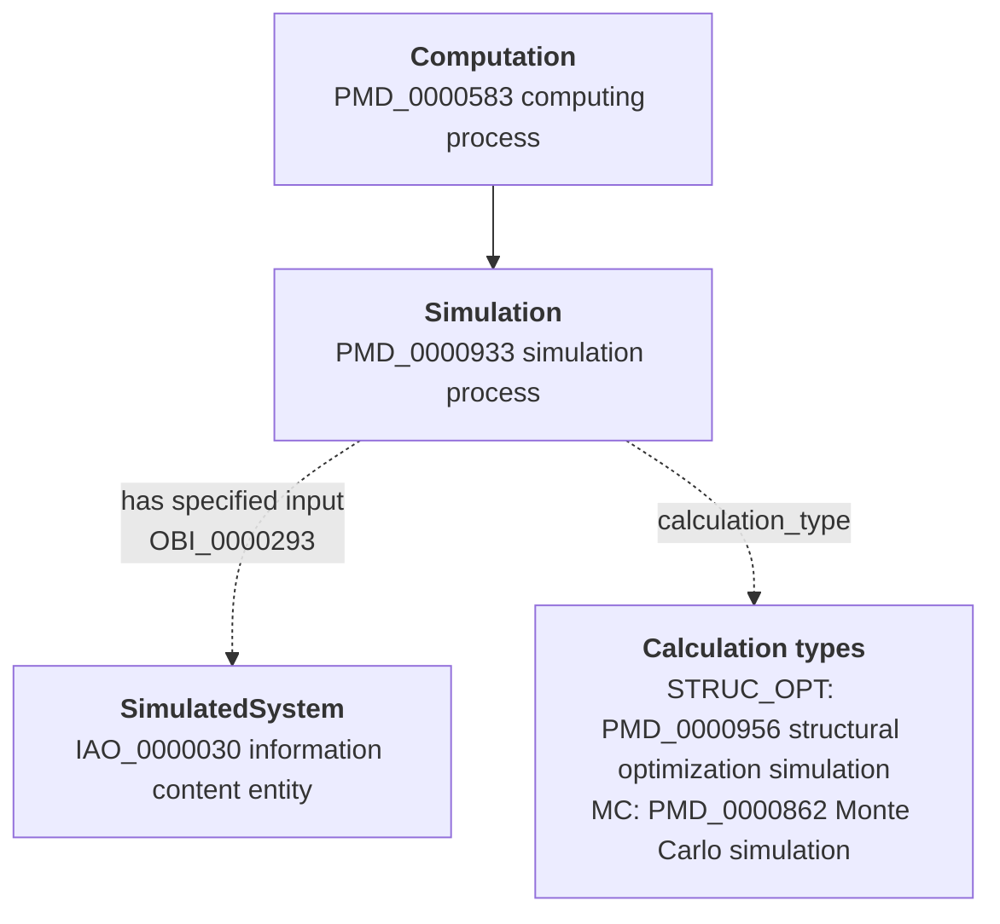

<p align="center">
  <picture>
    <source media="(prefers-color-scheme: dark)" srcset="assets/mermantics-logo-dark.svg">
    
  </picture>
</p>


Check a Mermaid data-model diagram against an OWL ontology, with a reasoner.

Many data models are sketched as Mermaid flowcharts, with ontology IDs written into the
boxes and arrows ("Simulation: local subclass of PMD_0000933", "has specified input
OBI_0000293"). `mermantics` reads such a diagram, turns it into OWL, and checks it
against the ontology it claims to align with (by default PMDco 3.1.1):

1. **IDs**: every ID exists in the ontology, is not deprecated, and is the right kind
   (a class on a box, a property on an arrow).
2. **Labels**: the text written next to each ID matches the ontology's label.
3. **Schema** (reasoner): no box becomes an impossible class, for example a box that sits
   under "information content entity" but is aligned to "material entity".
4. **Domain and range**: each arrow fits the domain and range of its property, including
   ones inherited from super-properties and inverses. A reasoner never reports these on
   its own; it silently infers new types instead, so they are checked separately.
5. **Vocabularies**: terms in a vocabulary box are kinds of the class that uses them.
6. **Example data** (reasoner): one example instance per box, linked by every arrow, is
   consistent with the ontology.

When the reasoner finds a problem, the report includes its explanation: the chain of
axioms that leads to the contradiction.

## Install

```bash
pip install mermantics
```

The reasoner checks (3 and 6) need **Java 11 or newer**. On first use, `mermantics`
downloads [ROBOT](https://robot.obolibrary.org) (v1.9.11) and the ontology into a cache
folder (`~/.cache/mermantics`, or `$MERMANTICS_CACHE`). Without Java, use `--fast`
to run checks 1, 2, 4 and 5 only.

## Usage

```bash
mermantics model.mmd                     # check against PMDco 3.1.1
mermantics model.mmd --fast              # no reasoner, about a second
mermantics model.mmd -o my-ontology.ttl  # another ontology (file, URL or pmdco:<version>)
mermantics model.mmd --report report.md --json report.json
```

Exit codes: `0` no errors, `1` errors found, `2` the tool could not run (missing file,
no Java, download failed). Warnings and notes never fail the run.

A run against the full PMDco takes about 40 seconds: one reasoner pass for the class
structure and a quicker consistency check for the example data.

## How the diagram is read

Mermaid has no meaning of its own, so the tool relies on a few conventions. All of them
can be changed with options.

| In the diagram | Read as |
|---|---|
| First ID in a box label, e.g. `PMD_0000933` | The box's alignment: a subclass of that ontology class (never equivalence) |
| Unlabelled solid arrow `Parent --> Child` | Schema inheritance: Child is a subclass of Parent (`--inherit child-parent` to flip) |
| Dotted, thick or labelled arrow `A -. "has part<br>BFO_0000051" .-> B` | A relation between instances; the first ID in the label is the property |
| Box with style class `note` | Ignored (`--skip-class`) |
| Box with style class `vocab` | A vocabulary: its terms should be subclasses of the class pointing at it (`--vocab-class`) |
| IDs with prefix `PMD` | `https://w3id.org/pmd/co/PMD_...`; any other prefix becomes an OBO PURL (`--prefix XYZ=https://...`) |

An ID is an upper-case prefix, an underscore and 5 to 9 digits (`IAO_0000030`), so names
like `MAT_SIM_STRUCTURE` are not mistaken for IDs. Labels may use `<br>`, `<b>` and HTML
entities. Lines the parser does not understand are reported, never silently dropped.

A small example:



## Using it in CI

```yaml
# .github/workflows/check-diagrams.yml
name: Check data-model diagrams
on: [push, pull_request]
jobs:
  check:
    runs-on: ubuntu-latest
    steps:
      - uses: actions/checkout@v4
      - uses: actions/setup-java@v4
        with: { distribution: temurin, java-version: "21" }
      - uses: actions/setup-python@v5
        with: { python-version: "3.12" }
      - uses: actions/cache@v4
        with: { path: ~/.cache/mermantics, key: mermantics-${{ runner.os }} }
      - run: pip install mermantics
      - run: mermantics docs/data-model.mmd --report report.md
```

## Limitations

- Only flowcharts. Nodes defined inline inside an arrow (`A["x"] --> B`) are not
  supported; define the node on its own line.
- The example-data check uses one instance per box. A box that is both input and output
  of the same process gets one instance for both.
- Domain and range checks understand named classes, unions and intersections; other
  class expressions are reported as "could not check".
- The label check is a text comparison. A label on the same line as its ID that does not
  match is a warning; when only the neighbouring lines are there and none match, it is a
  note (the label was probably just not written down).
- The reasoner is only as good as the ontology's axioms: if the ontology does not say two
  classes are disjoint, mixing them up is not a contradiction.

## Development

```bash
pip install -e ".[test]"
pytest -m "not reasoner"              # fast tests, no Java needed
pytest -m "reasoner and not pmdco"    # reasoner on a tiny test ontology, a few seconds
PMDCO_FILE=/path/to/pmdco-full.ttl pytest -m pmdco   # full PMDco runs, a few minutes
```

`tests/fixtures/` contains a real simulation data-model diagram and three deliberately
broken copies (unknown ID, impossible class, misused relation) with the expected results.

## License

To be decided.
